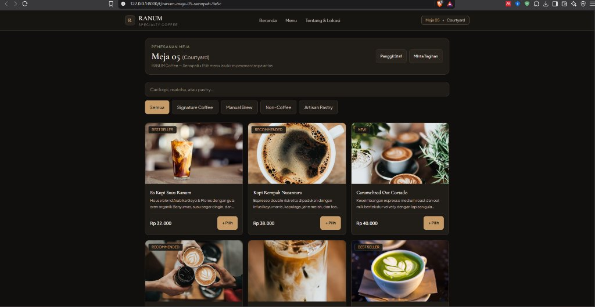
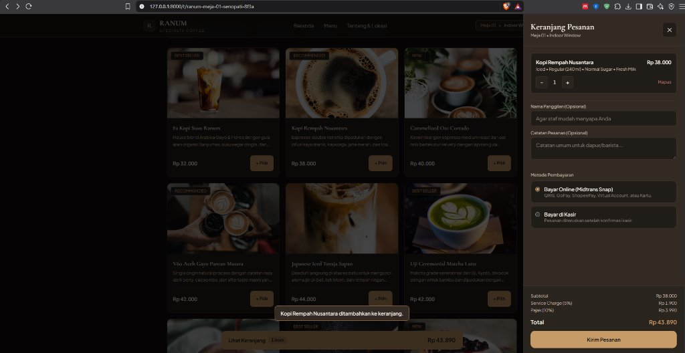
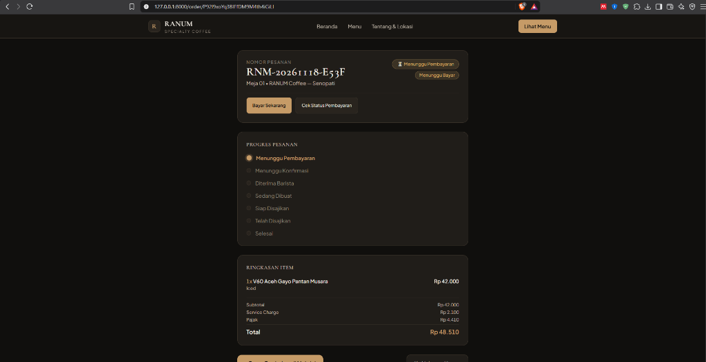

# RANUM Coffee

> *Where Every Sip Has a Story.*

Platform web coffee shop yang menggabungkan **website brand**, **katalog menu digital**, **QR Table Ordering** langsung dari meja, **pembayaran online Midtrans Snap**, serta **dashboard operasional staf & admin** dengan tema visual **Dark Mode Elevation**.

---

## Preview Tampilan

| Pemesanan Menu QR Meja | Keranjang & Checkout |
| :---: | :---: |
|  |  |

| Pelacakan Status Pesanan |
| :---: |
|  |

---

## Fitur & Fungsi Utama

### 1. Website Publik & Brand
- **Beranda (`/`):** Hero editorial, status outlet (Buka/Tutup), menu unggulan, cerita asal kopi Nusantara, dan informasi kunjungan.
- **Menu Digital (`/menu`):** Filter kategori, pencarian produk, badge (`BEST SELLER`, `NEW`, `RECOMMENDED`), dan status ketersediaan.
- **Tentang & Lokasi (`/about`):** Profil brand, alamat outlet flagship, dan jam operasional.

### 2. Customer QR Table Ordering & Tracking
- **Pemesanan via QR Meja (`/t/{token}`):** Validasi token QR unik per meja, tampilan identitas meja otomatis, pilihan varian (Suhu, Ukuran, Gula, Susu), add-on, catatan per item & per order, serta tombol *Panggil Staf* dan *Minta Tagihan*.
- **Keranjang & Checkout:** Perhitungan otomatis subtotal, *service charge*, dan pajak di server; proteksi *idempotency key* untuk mencegah order ganda; pilihan **Bayar Online (Midtrans Snap)** atau **Bayar di Kasir** (jika diaktifkan).
- **Embedded Midtrans Snap Pop-up:** Pembayaran QRIS, GoPay, ShopeePay, Virtual Account, dan Kartu tampil langsung di dalam modal pop-up pada halaman yang sama.
- **Pelacakan Status Pesanan (`/order/{accessToken}`):** Pembaruan status realtime (SSE + fallback polling) dari `Awaiting Payment` hingga `Completed`, serta tombol pesan tambahan dalam satu sesi meja.

### 3. Portal & Dashboard Operasional Staf (`/staff/login` & `/staff/dashboard`)
- **Role-Based Access Control (RBAC):**
  - **Admin / Owner:** Akses penuh — manajemen menu & stok, meja & cetak/regenerasi QR, akun staf, pengaturan outlet (pajak, service charge, jam buka, opsi bayar di kasir), laporan penjualan, grafik pemasukan, ekspor CSV, dan audit log.
  - **Kasir:** Konfirmasi/pembatalan pesanan, catat pembayaran tunai manual, tutup sesi meja, dan pantau riwayat pembayaran.
  - **Barista:** Antrean produksi (`Confirmed` → `Preparing` → `Ready`).
  - **Waiter:** Antrean penyajian (`Ready` → `Served`) dan penyelesaian permintaan meja.
- **Grafik Pemasukan:** Visualisasi pendapatan lunas berdasarkan periode **Harian**, **Bulanan**, dan **Tahunan**.

### 4. Keamanan
- Verifikasi signature `SHA512` webhook Midtrans & pemrosesan idempoten.
- *Server-side price & stock validation* serta *price snapshot* pada setiap item order.
- Multi-tier rate limiting anti-DDoS & anti-*brute force*, `helmet`, pembatasan ukuran payload (`100kb`), CORS ketat, dan HTTP Security Headers / CSP di Laravel.

---

## Arsitektur & Struktur Proyek

```text
RanumCoffee/
├── apps/
│   ├── api/          # Backend REST API (NestJS + TypeScript + Prisma + MySQL)
│   └── web/          # Presentation & Web Layer (Laravel 13 + Blade + Tailwind CSS v4 + TypeScript)
├── .gitignore        # Batasan file sensitif & build artifact agar tidak ter-push ke GitHub
└── README.md
```

---

## Prasyarat & Dependency

Pastikan perangkat Anda sudah terpasang:
- **Node.js** `>= 20.x` (disarankan v22/v24) & **npm**
- **PHP** `>= 8.3` & **Composer**
- **MySQL** `8.x` (atau MariaDB / MySQL bawaan XAMPP)

### Dependency Utama
- **Backend (`apps/api/package.json`):** `@nestjs/core`, `@nestjs/jwt`, `@nestjs/passport`, `@nestjs/swagger`, `@nestjs/throttler`, `@prisma/client`, `prisma`, `bcryptjs`, `class-validator`, `helmet`, `qrcode`.
- **Frontend (`apps/web/composer.json` & `package.json`):** `laravel/framework` (v13), `tailwindcss` (`@tailwindcss/vite` v4), `typescript`, `vite`.

---

## Panduan Instalasi & Menjalankan Secara Lokal

### 1. Siapkan Database MySQL
Buat database kosong bernama `ranum_coffee` di MySQL (contoh menggunakan XAMPP MySQL CLI):
```powershell
C:\xampp\mysql\bin\mysql.exe -u root -e "CREATE DATABASE IF NOT EXISTS ranum_coffee CHARACTER SET utf8mb4 COLLATE utf8mb4_unicode_ci;"
```

### 2. Setup Backend (`apps/api`)
```powershell
cd d:\RanumCoffee\apps\api
npm install
copy .env.example .env
```
Sesuaikan nilai di `apps/api/.env` (`DATABASE_URL`, `JWT_SECRET`, `FRONTEND_URL`, serta `MIDTRANS_SERVER_KEY` dan `MIDTRANS_CLIENT_KEY`), lalu jalankan migrasi & seed data awal:
```powershell
npx prisma generate
npx prisma db push
npx esbuild prisma/seed.ts --bundle --platform=node --format=esm --outfile=dist/seed.mjs --external:@prisma/client --external:bcryptjs
node dist/seed.mjs
```

### 3. Setup Frontend (`apps/web`)
```powershell
cd d:\RanumCoffee\apps\web
composer install
npm install
copy .env.example .env
php artisan key:generate
npm run build
```
Sesuaikan `MIDTRANS_CLIENT_KEY` dan `NEST_API_URL` / `NEST_PUBLIC_API_URL` di `apps/web/.env`.

### 4. Menjalankan Aplikasi (3 Tab PowerShell)
- **Tab 1 (MySQL):** Jalankan MySQL dari XAMPP Control Panel atau:
  ```powershell
  C:\xampp\mysql\bin\mysqld.exe --defaults-file=C:\xampp\mysql\bin\my.ini --standalone
  ```
- **Tab 2 (NestJS API — Port `3001`):**
  ```powershell
  cd d:\RanumCoffee\apps\api
  npm run start:dev
  ```
- **Tab 3 (Laravel Web — Port `8000`):**
  ```powershell
  cd d:\RanumCoffee\apps\web
  php artisan serve --host=127.0.0.1 --port=8000
  ```

---

## Akses URL & Akun Awal (Seed)

- **Website Utama:** `http://127.0.0.1:8000/`
- **Katalog Menu:** `http://127.0.0.1:8000/menu`
- **Demo QR Meja 01:** `http://127.0.0.1:8000/t/ranum-meja-01-senopati-8f3a`
- **Portal Staf:** `http://127.0.0.1:8000/staff/login`
- **Swagger API Docs (Non-Production):** `http://127.0.0.1:3001/api/docs`

| Role | Email | Password Default |
|---|---|---|
| Admin / Owner | `admin@ranumcoffee.id` | `RanumAdmin2026!` |
| Kasir | `kasir@ranumcoffee.id` | `RanumKasir2026!` |
| Barista | `barista@ranumcoffee.id` | `RanumBarista2026!` |
| Waiter | `waiter@ranumcoffee.id` | `RanumWaiter2026!` |

> **Keamanan:** Ubah seluruh password default dan `JWT_SECRET` sebelum digunakan di lingkungan production.
